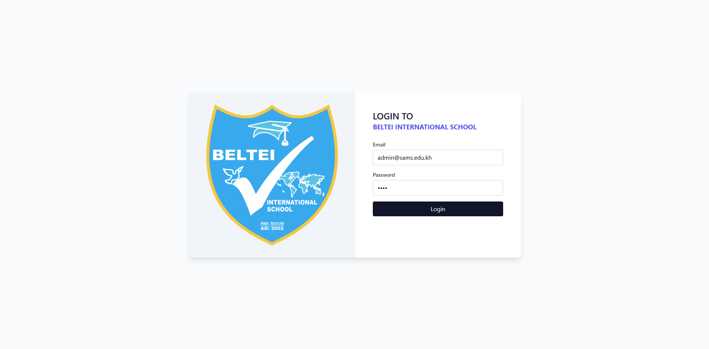
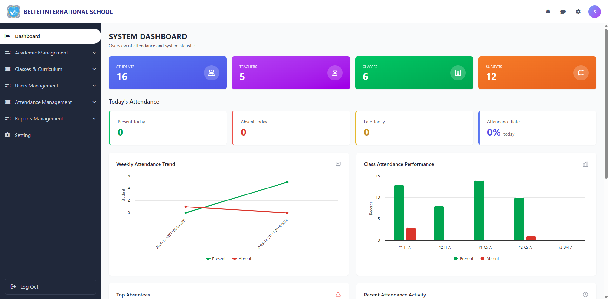
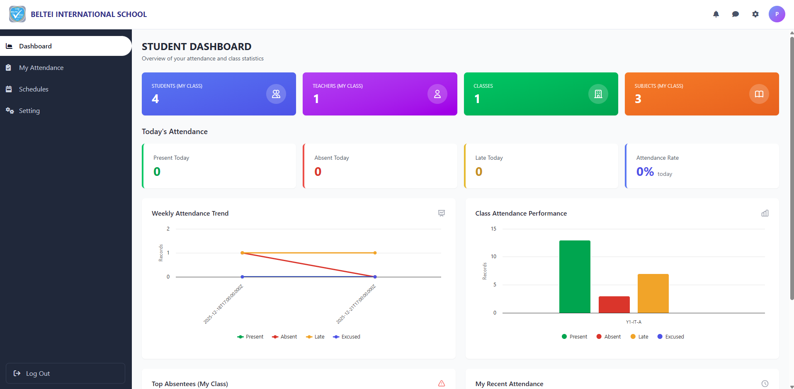

# 🎓 School Attendance Management System (SAMS) – Frontend

<div align="center">

**Vue 3 • Vite • Tailwind CSS • Chart.js**

[](https://vuejs.org/)
[](https://nodejs.org/)
[](LICENSE)

</div>

A modern Vue 3 application built with Vite, featuring comprehensive tools for school attendance management, data visualization, QR code integration, PDF generation, and facial recognition.

---

## ✨ Features

### 🎯 Core Features
- **Vue 3** with Composition API
- **Real-time Attendance** tracking system
- **Role-based Access Control** (Admin, Teacher, Student)
- **Interactive Dashboard** with analytics

### 📊 Data Visualization
- **Chart.js & Highcharts** - Interactive charts and graphs
- **Vue-ChartJS** - Attendance statistics and reports
- **Data Export** - Generate Excel reports

### 🗺️ Additional Features
- **Map Visualization** - Leaflet for interactive maps
- **QR Code System** - Generate and scan QR codes for attendance
- **PDF Generation** - Create professional PDFs with tables and reports
- **Facial Recognition** - Face detection and recognition for attendance
- **Modern UI** - Beautiful Tailwind CSS styling
- **Sweet Alerts** - Elegant notification modals

---

## 📋 Prerequisites

- **Node.js** >= 16.x
- **npm** >= 8.x or **yarn**
- **Git**

---

## 🔧 Installation

### 1️⃣ Clone the repository

```bash
git clone https://gitlab.com/testing980844/frontend.git
cd frontend
```

### 2️⃣ Install dependencies

```bash
npm install
```

### 3️⃣ Configure environment (optional)

Create a `.env` file in the root directory if needed:

```env
VITE_API_URL=http://localhost:4000
VITE_APP_NAME=SAMS
```

---

## 🚀 Running the Application

### Development Mode

```bash
npm run dev
```

The application will be available at: **http://localhost:8080/**

### Production Build

```bash
npm run build
```

### Preview Production Build

```bash
npm run preview
```

---

## 🔐 Default Login Credentials

### 👨‍💼 Admin Login

**Email:**
```
admin@sams.edu.kh
```

**Password:**
```
1234
```

---

### 👨‍🏫 Teacher Login

**Email:**
```
chenda.keo@sams.edu.kh
```

**Password:**
```
1234
```

---

### 👨‍🎓 Student Login

**Email:**
```
vannak.sok@sams.edu.kh
```

**Password:**
```
1234
```

---

## 📦 Dependencies

### Core Libraries

| Package | Version | Description |
|---------|---------|-------------|
| **vue** | ^3.5.24 | Progressive JavaScript framework |
| **vue-router** | ^4.6.3 | Official router for Vue.js |
| **axios** | ^1.13.2 | Promise-based HTTP client |

### UI & Visualization

| Package | Version | Description |
|---------|---------|-------------|
| **chart.js** | ^4.5.1 | Simple yet flexible charting |
| **vue-chartjs** | ^5.3.3 | Vue wrapper for Chart.js |
| **highcharts** | ^12.4.0 | Advanced charting library |
| **leaflet** | ^1.9.4 | Interactive map library |
| **@fortawesome/vue-fontawesome** | ^3.1.2 | Icon library |
| **@fortawesome/fontawesome-svg-core** | ^7.1.0 | FontAwesome core |
| **@fortawesome/free-solid-svg-icons** | ^7.1.0 | FontAwesome icons |

### Utilities

| Package | Version | Description |
|---------|---------|-------------|
| **qrcode** | ^1.5.4 | QR code generation |
| **html5-qrcode** | ^2.3.8 | QR code scanning |
| **jspdf** | ^3.0.4 | PDF generation |
| **jspdf-autotable** | ^5.0.2 | PDF table generation |
| **xlsx** | ^0.18.5 | Excel file handling |
| **sweetalert2** | ^11.26.12 | Beautiful alerts and modals |
| **face-api.js** | ^0.22.2 | Face detection and recognition |

### Development Tools

| Package | Version | Description |
|---------|---------|-------------|
| **vite** | rolldown-vite@7.2.5 | Next generation frontend tooling |
| **@vitejs/plugin-vue** | ^6.0.1 | Vue 3 plugin for Vite |
| **tailwindcss** | ^3.4.18 | Utility-first CSS framework |
| **autoprefixer** | ^10.4.22 | PostCSS plugin |
| **postcss** | ^8.5.6 | CSS transformations |
| **vite-plugin-mkcert** | ^1.17.9 | HTTPS certificate generation |

---

## 🛠️ Tech Stack

- **Framework**: Vue 3 (Composition API)
- **Build Tool**: Vite (Rolldown)
- **Styling**: Tailwind CSS
- **Language**: JavaScript (ES modules)
- **State Management**: Vue Composition API
- **HTTP Client**: Axios
- **Dev Tools**: Hot Module Replacement, mkcert for HTTPS

---

## 📁 Project Structure

```
frontend/
├── src/
│   ├── assets/             # Static assets (images, fonts, etc.)
│   ├── components/         # Reusable Vue components
│   │   ├── admin/          # Admin-specific components
│   │   ├── teacher/        # Teacher-specific components
│   │   ├── student/        # Student-specific components
│   │   └── common/         # Shared components
│   ├── views/              # Page components (routes)
│   │   ├── AdminDashboard.vue
│   │   ├── TeacherDashboard.vue
│   │   ├── StudentDashboard.vue
│   │   └── Login.vue
│   ├── router/             # Vue Router configuration
│   │   └── index.js
│   ├── services/           # API service layer
│   │   └── api.js
│   ├── utils/              # Utility functions
│   ├── App.vue             # Root component
│   └── main.js             # Application entry point
├── public/                 # Public static files
├── docs/
│   └── images/             # Documentation images
├── index.html              # HTML entry point
├── package.json            # Project dependencies
├── vite.config.js          # Vite configuration
├── tailwind.config.js      # Tailwind configuration
├── postcss.config.js       # PostCSS configuration
└── README.md               # This file
```

---

## 🎨 Screenshots

### Login Page


### Admin after login


### Teacher after login


### Student after login


---

## 🔒 Security

- This project uses **mkcert** for local HTTPS development
- Ensure certificates are properly configured for your development environment
- JWT tokens are used for authentication
- All API requests are secured with authentication headers

---

## 📝 Available Scripts

| Command | Description |
|---------|-------------|
| `npm run dev` | Start development server with HMR |
| `npm run build` | Build for production |
| `npm run preview` | Preview production build locally |
| `npm install` | Install all dependencies |

---

## 🧪 Testing

To test the application with different user roles:

1. **Start the backend server** (ensure it's running on port 4000)
2. **Start the frontend** with `npm run dev`
3. **Login** with one of the default credentials above
4. **Test features** according to the user role

---

## 🚧 Development Workflow

### Adding a new feature

```bash
# Create a new branch
git checkout -b feature/your-feature-name

# Make your changes
# ...

# Commit your changes
git add .
git commit -m "Add: your feature description"

# Push to GitLab
git push origin feature/your-feature-name

# Create a Merge Request on GitLab
```

---

## 🐛 Troubleshooting

### ❌ Port already in use

If port 8080 is already in use, Vite will automatically use the next available port. Check the terminal output for the correct URL.

### ❌ Module not found

```bash
# Clear node_modules and reinstall
rm -rf node_modules package-lock.json
npm install
```

### ❌ Cannot connect to backend API

Ensure the backend server is running and the API URL in your configuration is correct.

### ❌ HTTPS certificate issues

```bash
# Regenerate certificates
npm run dev
# Accept the certificate in your browser
```

---

## 🤝 Contributing

We welcome contributions! Please follow these steps:

1. **Fork** the repository
2. **Create** your feature branch
   ```bash
   git checkout -b feature/AmazingFeature
   ```
3. **Commit** your changes
   ```bash
   git commit -m 'Add some AmazingFeature'
   ```
4. **Push** to the branch
   ```bash
   git push origin feature/AmazingFeature
   ```
5. **Open** a Merge Request on GitLab

### Code Style Guidelines

- Use **Vue 3 Composition API**
- Follow **ES6+ standards**
- Write **meaningful commit messages**
- Add **comments** for complex logic
- Keep components **small and reusable**

---

## 📄 License

**Private** - This project is for educational purposes only.

---

## 👥 Authors

**Phearom Chea**  
Year 4 - Software Engineering (SE2)

---

## 📧 Support

For support or questions:

- **Email**: phearomchea210920@gmail.com
- **GitLab Issues**: [Open an issue](https://gitlab.com/testing980844/frontend/-/issues)

---

## 🔗 Related Repositories

- **Backend API**: [SAMS Backend](https://gitlab.com/testing980844/backend)
- **Documentation**: [SAMS Docs](https://gitlab.com/testing980844/docs)

---

## 🙏 Acknowledgments

- Vue.js Team for the amazing framework
- Tailwind CSS for the utility-first CSS framework
- All open-source contributors of the libraries used in this project

---

<div align="center">

**Built with ❤️ for School Attendance Management**


</div>